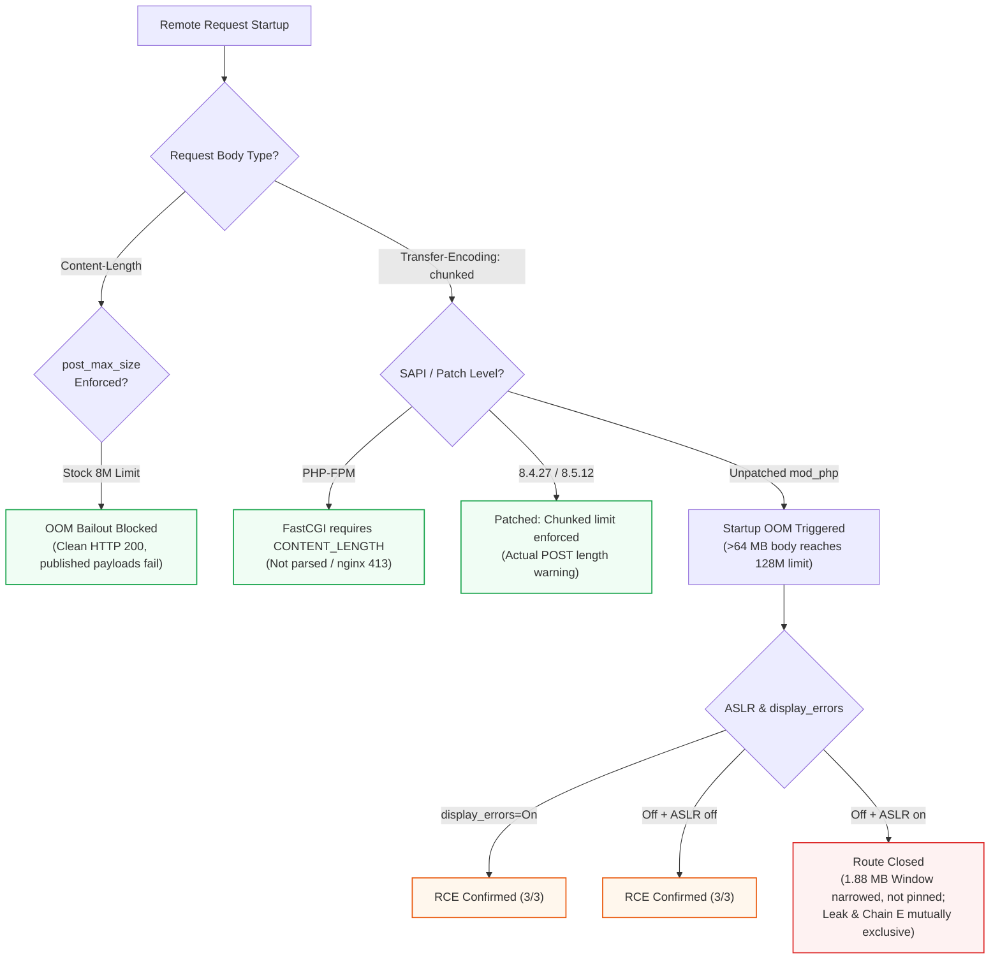

<div align="center">

# php2shell — Independent Verification & Exploitation Boundary Audit
### CVE-2026-109618 · CVE-2026-109619 · CVE-2026-115560

[-0284c7?style=flat-square&logo=github)](https://github.com/JoshRob297/php2shell-research/releases/tag/v1.0.0)
[](#)
[](#)
[-d97706?style=flat-square)](#)
[-059669?style=flat-square&logo=adobeacrobatreader)](https://github.com/JoshRob297/php2shell-research/releases/tag/v1.0.0)

**An exhaustive memory-allocator & microarchitecture study by JoshRob**  
*Independent verification of public ASLR bypass claims, chunked POST boundaries, and Zend MM free-list heap disclosure.*

---
</div>

- **Status**: final public release v1.0.0, 2026-10-24 (allocator microarchitecture, chunked SAPI boundaries, and FPM/mod_php route closures).
- **Scope**: PHP 8.4.x and adjacent branches (8.2, 8.3, 8.5), official PHP container images, public proof-of-concept code, and independent lab reproduction.
- **Application scope**: a Nextcloud 33.0.x test deployment (PHP 8.4.21, Apache `mod_php` prefork) was used to validate the exposed configuration and patch level. The RCE proof was obtained on the official `php:8.4.26-apache` image. The bug is in PHP request startup, not Nextcloud code.
- **Artifacts**: formal typography PDF releases (`REPORT.pdf` and `RESUMEN.pdf`), reproducible lab instrumentation (`tooling/labkit/`), offline reachability calculators, and detection rules.
- **AI-assisted**: multiple AI models and specialized subagents were used under human direction for review, lab orchestration and documentation checks; every finding was validated against commands, outputs or public sources. See `METHODOLOGY.md`.

## Executive summary

Two CVEs were assigned to a cluster of bugs in PHP request startup:

- **CVE-2026-109618**: state corruption via bailout during request startup.
- **CVE-2026-109619**: session decode OOM followed by stale global state.

A third issue in the same feature, **CVE-2026-115560**, was disclosed on 2026-10-23 in an informational advisory. It is unfixed by the emergency releases and requires an unusual condition: the application configures `session.serialize_handler` as `php_binary` or `php_serialize` and then switches it back to `php` at runtime with `ini_set()` before `session_start()`. Mitigation: `session.upload_progress.enabled=0`. This report does not test it; our test deployment does not meet the condition.

The vulnerabilities are pre-authentication and run before application code. In a vulnerable `mod_php` prefork deployment with session upload progress enabled and a sufficiently large request body, a remote attacker can corrupt worker state, disclose process memory, and in the tested conditions achieve remote code execution as the web user. Denial of service through worker aborts is also possible.

The vendor fixed the OOM/state-corruption class in PHP 8.4.27 (and the corresponding 8.3.36, 8.2.35 and 8.5.12 releases). The fix is necessary but not sufficient for every public exploit chain: the request-level A/C/E chains described by public PoCs still worked against 8.4.27 and 8.5.12 in our lab when their prerequisites were present. `session.use_strict_mode=1` blocked the fixed-session variant of chain A in our tests; the other chains require application-level or local conditions.

---

## Critical Real-World Boundaries



> [!NOTE]
> **1. Default limits stop the published payloads, and the chunked route is version-scoped.**  
> Standard out-of-the-box PHP configurations use `memory_limit = 128M` and `post_max_size = 8M`. In re-runs against vanilla defaults, the published multipart payloads (~3.7 MB) do not trigger an Out-Of-Memory (OOM) bailout (clean HTTP 200), and any body sent with a `Content-Length` is capped at `post_max_size`. On **unpatched** branches (8.2.34, 8.3.35, 8.4.26) `post_max_size` is not enforced on chunked bodies: a chunked 30 MB multipart parses in full and a chunked 70 MB multipart OOMs at request startup. The **8.4.27/8.5.12 patch closes this**: chunked bodies are bounded with `Actual POST length does not match Content-Length, and exceeds 8388608 bytes`. The route is also `mod_php`-only: PHP-FPM needs `CONTENT_LENGTH` (chunked bodies are not parsed) and nginx's body cap applies to chunked. See `EVIDENCE.md` section 12.

> [!IMPORTANT]
> **2. The Session HashTable Is Out of the Cookie Window, but the Channel Leaks Heap:**  
> Using non-intrusive GDB worker probing (`php_session_reset_id` & `php_session_track_init`), we tracked `PS(id)` and session `HashTable` allocations across requests. Due to the LIFO release order of superglobals, the `HashTable` is consistently positioned **before** the `PS(id)` pointer or separated across different 2 MB allocator chunks (delta > 4.5 MB), so the forward cookie window cannot reach session data. Testing with custom destructor objects (`pDestructor`) confirmed that userland destructor ordering cannot reorder the pre-request allocations done during `rfc1867_post_handler`.  
> The forged cookie does over-read past its own filler: the measured 4000/5000-byte values carry 525-841 bytes outside the session alphabet, including **47 pointer-like values** inside the id's 2 MB chunk (Zend MM bin-64 free-list links), disclosing the chunk base. The distance from that base to libphp text varied between `0x289bc00` and `0x2a7dc00` (1.88 MB) across 20 ASLR-on runs, with the low 12 bits constant (`delta % 0x1000 == 0xc00`), so the leak **narrows libphp to a ~481-page window but does not pin it**. This is a heap-disclosure primitive, not the session-table read and not a demonstrated full ASLR bypass. See `validation/`.

```mermaid
flowchart LR
    subgraph Chunk_Cached["2 MiB Cached Chunk (Attacker Reachable)"]
        direction TB
        ID["PS(id) Stale Buffer\n(4000 B forged zend_string)"]
        FL["Zend MM Bin-64 Free-List Links\n(47 heap pointers leaked)"]
        Boundary["Chunk Boundary\n(8,168 B max window)"]
        ID --> FL --> Boundary
    end

    subgraph Chunk_Main["2 MiB Main Chunk (Unreachable)"]
        HT["Session HashTable\n(Target libphp pointer)"]
    end

    Boundary -.->|Delta: +8,745,096 B (Unreachable)| HT
    
    style Chunk_Cached fill:#f0f9ff,stroke:#0284c7,stroke-width:1.5px
    style Chunk_Main fill:#fef2f2,stroke:#ef4444,stroke-width:1.5px
    style HT fill:#fee2e2,stroke:#b91c1c
    style ID fill:#e0f2fe,stroke:#0369a1
```

> [!WARNING]
> **3. The leak channel is `mod_php`-only.**  
> On FPM, payload A makes the worker exit (pool logs `child ... exited with code 70`, nginx returns 502); the follow-up request runs in a new process with a fresh 32-byte id and never reuses the stale one.

> [!WARNING]
> **4. The leak and the stale-`BG(unserialize)` primitive (E-OOM) are mutually exclusive.**  
> This closes the remaining `Off` + ASLR-on route. On `mod_php` the E-OOM primitive exists in isolation (a decode OOM leaves `BG(unserialize)` at `level=1` with a dangling `data` pointer and the next decode reuses it without a crash), but payload A's OOM in `php_session_send_cookie` clears exactly that state (`level=0`), and the decode-OOM producer leaves no stale session id. One request cannot produce both states (the decode runs before the cookie is sent); separate requests destroy each other's.

---

## Key results

| Test Target / Condition | Environment & Constraints | Verified Impact / State | Verdict | Evidence |
|---|---|---|:---:|:---:|
| `mod_php` 8.4.26 | `display_errors=On` · ASLR On | Pre-auth Remote Code Execution | `CRITICAL (3/3)` | Section 2 |
| `mod_php` 8.4.26 | `display_errors=Off` · ASLR Off | Remote Code Execution via static offsets | `HIGH (3/3)` | Section 2 |
| `mod_php` 8.4.26 | `display_errors=Off` · ASLR On | Heap Disclosure (1.88 MB Window narrowed, not pinned) | `MITIGATED` | Section 11 |
| FPM 8.4.26 (Cookie Leak) | Single-worker pool | Worker aborts on OOM (`exit 70`, 502); fresh worker gets fresh 32B SID | `NO CHANNEL` | Section 11 |
| `mod_php` (Leak + E-OOM) | Single-worker pool | Bailout clears `BG(unserialize)`; states mutually exclusive | `ROUTE CLOSED` | Section 11 |
| CVE-2026-115560 | `php_binary` config + runtime `ini_set()` | Bounded attempt: decode failure observed, no memory safety impact | `INCONCLUSIVE` | Section 12 |
| Chunked `post_max_size` | Unpatched (8.2.34 / 8.3.35 / 8.4.26) | 30M parses full, 70M OOMs on 128M limit (worker lives) | `BYPASS CONFIRMED` | Section 12 |
| Chunked `post_max_size` | Patched (8.4.27 / 8.5.12) | Rejected: `Actual POST length does not match Content-Length` | `PATCHED` | Section 12 |
| Chain D (`EG` at shutdown) | Unpatched `mod_php` | `EG(objects_store)` identical before/after OOM; no crash | `UNSUPPORTED` | Section 12 |
| `mod_php` 8.4.27 Control | Default Limits (128M / 8M) | Clean execution, no memory corruption | `PATCHED (0/5)` | Section 7 |
| A/C/E Request-level chains | 8.4.26 / 8.4.27 / 8.5.12 | RCE conditional on application sinks (LFI / gadget / handler) | `APP DEPENDENT` | Section 3 |
| Chain A with `strict=1` | All versions | File under attacker-chosen SID absent; injection blocked | `PREVENTED` | Section 3 |
| E-OOM FPM (CVE-2026-109619) | Planted 24B session · ASLR Off | Controlled 16B write to `sapi_module.ub_write` = `&system` | `LAB ONLY` | Section 10 |

---

## Repository contents

| File | Contents |
|---|---|
| `REPORT.md` | Full technical report: root cause, exploitation model, impact, limitations |
| `RESUMEN.md` | Resumen ejecutivo en español |
| `EVIDENCE.md` | Sanitized lab evidence, matrices and raw output excerpts (sections 1–12) |
| `validation/` | Sanitized `PS(id)` vs HashTable matrix, allocator geometry and interpretation |
| `tooling/` | `oom_reach.py`, `forged_cookie_check.py`, and instrumented labkit replica |
| `detection/` | Additive Suricata 8 and Sigma rules (forged cookie, groom signatures, abort bursts) |
| `raw/` | Redacted raw lab captures backing the OOM/ASLR rows |
| `METHODOLOGY.md` | Lab setup, application scope, AI/subagent workflow and reproducibility |
| `POCS.md` | Public PoCs reviewed and independent verification results |
| `REMEDIATION.md` | Vendor patch, configuration hardening, detection and verification |
| `COVERAGE.md` | Test matrix by CVE, chain, version and status |
| `FAQ.md` | Common questions and scope clarifications |
| `GLOSSARY.md` | Terms used in the report |
| `REFERENCES.md` | Primary and secondary public sources |
| `LICENSE` | CC BY 4.0 license notice |

> [!TIP]
> **Official Formatted PDF Release**: Formatted typography versions of `REPORT.md` (13 pages, A4) and `RESUMEN.md` (4 pages, A4) with verified checksums are available on the [v1.0.0 Release Page](https://github.com/JoshRob297/php2shell-research/releases/tag/v1.0.0).

---

## Method & Scope

All experiments were performed on loopback interfaces with disposable containers and official PHP images. No production system was targeted. Public exploit code was executed only in the lab; this repository does not redistribute it. Commands and results are included where they are reproducible without exposing private infrastructure.

A Nextcloud 33.0.x test deployment (PHP 8.4.21, `mod_php` prefork) was used to validate the exposed configuration and patch level; the RCE proof was on the official `php:8.4.26-apache` image. The analysis used multiple AI models and specialized subagents under human direction; see `METHODOLOGY.md` for the workflow and evidence rules.

## Responsible use

This material is for defensive research, patch verification and controlled testing. Do not use the described techniques against systems you do not own or have explicit authorization to test. For vulnerabilities in PHP itself, follow the PHP project security process.

The lab proof-of-concept code is not part of this repository. It lives in a separate private, invite-only repository and is available on request from the author (JoshRob) to vetted reviewers. Public PoCs are referenced by URL in `POCS.md`.
