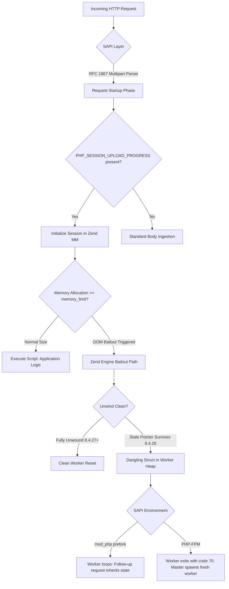
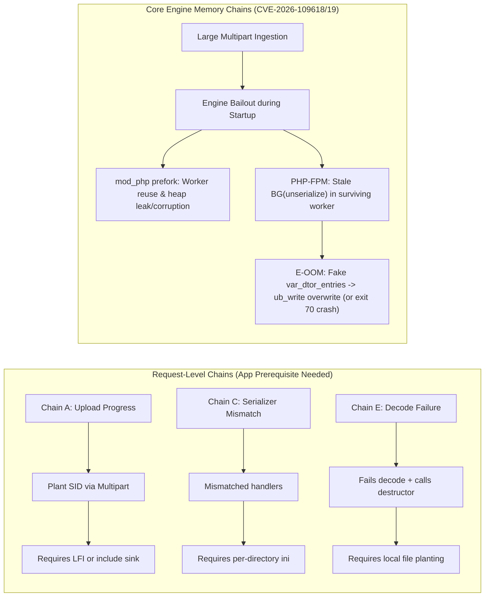

# php2shell: technical report

**CVE-2026-109618 / CVE-2026-109619 / CVE-2026-115560**

Version 1.7, 2026-10-26. Prepared by **JoshRob**. Independent security research. No hostnames,
addresses, credentials or customer data.

Changelog: v1.1 documented the FPM stale-BG chain reproduction. v1.2 records the definitive crash
mechanism of that chain (allocator free-list encoding, DoS), retracts an earlier misreading of
the watchpoint evidence, and closes the 8.5 `fatal_error_backtraces` and OPcache arms with
symbol builds and controlled differentials (see section 6 and `EVIDENCE.md`). v1.3 verified the
fixed branches (8.5.12, 8.3.36, 8.2.35). v1.4 evaluated `PS(serializer)` without reset (no stale
handler). v1.5 documents the controlled-write variant of the FPM stale-BG chain (E-OOM) and the
full FPM command execution reached in the lab (section 5.5, section 9, `EVIDENCE.md` section
10); the v1.2 retraction covered the residual-block reading, not this controlled variant. v1.6
is an editorial revision: it labels the request-level arm E (decode failure + local file
planting) and the FPM stale-`BG(unserialize)` chain E-OOM. v1.7 integrates the post-mortem analysis
and lab reproduction of the StealMyBitcoin challenge, documenting the SAPI architecture disambiguation
(persistent CLI-server workers vs disposable FPM workers) and independent lab verification of Chain D
(forged `HashTable` -> `zif_system`).

## 1. Executive summary

`php2shell` is a cluster of vulnerabilities in PHP request startup. The three assigned CVEs cover
related manifestations of state corruption caused by out-of-memory (OOM) conditions and bailout
paths that do not fully unwind per-request state:

- **CVE-2026-109618** — state corruption via bailout during request startup.
- **CVE-2026-109619** — session decode OOM followed by stale global state.

The OOM/state-corruption bugs are pre-authentication: they occur before the application's PHP
code runs. In a vulnerable `mod_php` prefork deployment with session upload progress enabled, a
remote attacker can use large multipart requests to force worker aborts, pair a corrupted worker
with a later request, leak process memory, and in the tested conditions execute code as the web
user. Worker aborts also provide a denial-of-service primitive.

PHP 8.4.27 and the corresponding 8.3.36, 8.2.35 and 8.5.12 releases contain the vendor fix for
the OOM/state-corruption class. The fix is necessary. It is not a complete fix for every public
exploit chain: the request-level A/C/E chains still worked against 8.4.27 and 8.5.12 in our lab
when their prerequisites were present. A/C/E are not the same primitive as the OOM chain; their
prerequisites and impact are described in section 5.5.

## 2. Disclosure timeline

Times are UTC, from public sources.

| Date | Event |
|---|---|
| 2026-08-11 | First reports of the bug class |
| 2026-08-24 | Additional independent reports |
| 2026-09-21 | PHP begins the coordinated fix |
| 2026-10-20 15:00 | CVE identifiers leak with an incorrect 10.0 score |
| 2026-10-20 19:30 | PHP moves the release forward to 2026-10-21 |
| 2026-10-21 03:02 | A major CDN/WAF publishes preventive rules |
| 2026-10-21 07:41 | Early fixed container images appear before the release |
| 2026-10-21 07:43 | First attack traffic reported |
| 2026-10-21 11:35 | Large-scale exploitation via upload progress reported |
| 2026-10-21 14:00 | Coordinated release: 8.2.35, 8.3.36, 8.4.27, 8.5.12 |
| 2026-10-21 14:17 | NVD records both CVEs |
| 2026-10-21 20:30 | One vendor reports no exploitation in its partner base |
| 2026-10-22 | Independent lab reproduction and patch verification (this report) |
| 2026-10-22 | Amazon Threat Intelligence: first exploitation attempts on 2026-10-17, four days before the patches (multiple PoC payloads, anonymization-network source IPs) |
| 2026-10-23 | PHP publishes an informational advisory for a third issue, CVE-2026-115560 (same feature, narrow condition); fix deferred to the next regular release, mitigation `session.upload_progress.enabled=0` |

The leak and the early images compressed the patch window. The release was originally planned
for 2026-10-22 and was moved forward.

## 3. Affected and fixed versions

| Version | OOM/state-corruption CVEs | Request-level A/C/E chains |
|---|---|---|
| 8.4.21 | Vulnerable by version; not exploited in this report | Prerequisites dependent |
| 8.4.26 | Vulnerable (lab RCE) | RCE with lab prerequisites |
| 8.4.27 | Fixed (vendor) | Still work with lab prerequisites |
| 8.5.12 | Fixed (0/3 with the lab OOM chain; blocked at the heap leak stage) | Still work with lab prerequisites |
| 8.3.36 / 8.2.35 | Fixed (0/3 each with the lab OOM chain; blocked at the heap leak stage) | Not tested here |

**CVE-2026-115560 (informational advisory, 2026-10-23)** is a third issue in the same session
upload-progress feature, disclosed after the emergency release. It is **not fixed** by
8.4.27/8.3.36/8.2.35/8.5.12; PHP defers the fix to the next regular release and recommends
`session.upload_progress.enabled=0` until then. The condition is narrow: the application must
configure `session.serialize_handler` as `php_binary` or `php_serialize` **and then switch it
to `php` at runtime with `ini_set()` before `session_start()`**, with upload progress still
enabled. PHP describes it as an unlikely vector; no exploitation was reported as of
2026-10-24. This report did not test it, and our test deployment does not meet the condition
(default `php` serializer, no runtime switch).

The independent OOM/RCE reproduction used official `php:8.4.26-apache` and
`php:8.4.27-apache` images, and the same harness was run against `php:8.5.12-apache`,
`php:8.3.36-apache` and `php:8.2.35-apache` (0/3 each; the vulnerable control rerun in the same
harness gave 3/3). The request-level A/C/E differential additionally used `php:8.4.26-fpm`,
`php:8.4.27-fpm` and `php:8.5.12-fpm`. See `EVIDENCE.md` and `raw/fixed-branches-verify.txt`.

A **Nextcloud 33.0.x test deployment** running PHP 8.4.21 under Apache `mod_php` prefork was
used to validate the exposed configuration and patch level. The RCE proof was on the official
`php:8.4.26-apache` image; we did not execute the RCE against the Nextcloud deployment. The bug
is in PHP request startup, before application code, so the application name is not the
primitive; the deployment conditions determine exploitability.

## 4. Root cause

CWE mapping used in this report: CWE-416 (use-after-free), CWE-755 (improper handling of
exceptional conditions), CWE-824 (access of uninitialized pointer), CWE-1325 (improperly
controlled sequential memory allocation).

### 4.1 Request startup and bailout

PHP request startup allocates and initializes per-request globals before user code runs. An OOM
or fatal error during this phase can invoke `zend_bailout()`/`longjmp`. If the unwind is
incomplete, the worker can retain state that belongs to the aborted request. The next request
served by that worker then observes stale pointers, flags or session state.

The bug class is timing-dependent: the attacker must cause the abort and then get a later
request routed to the same worker. Multi-worker `mod_php` prefork and body-streaming proxies make
the pairing practical; buffering proxies and `KeepAlive` change the odds.

### 4.2 CVE-2026-109618

The advisory describes state corruption via bailout during request startup. In the lab, large
multipart bodies and low `memory_limit` values produced worker aborts and corrupted session
state. A second request could consume the stale state and leak memory or redirect execution.

### 4.3 CVE-2026-109619

The session module's decode path can run out of memory while reading a large session. The
`BG(unserialize)` state remains dirty after the abort. A later request that processes session
upload progress can consume that state, leading to object/destructor confusion and a
use-after-free. Public verification code demonstrates the OOM and stale-state sequence under
PHP-FPM; this report independently reproduced the stale-state sequence on PHP-FPM 8.4.26 to a
use-after-free crash (502) and verified that 8.4.27 closes it. A symbol build with a hardware
watchpoint shows the crash mechanism: the freed `struct php_unserialize_data` run is recycled as
an allocator page for bin 16, and the free-list construction overwrites `used_slots` with an
encoded pointer (`bswap` store in `zend_mm_alloc_small_slow`); `var_push` then writes outside
the mapping and the worker dies (deterministic 502). That is the default behavior when the freed
run is not reclaimed by attacker data. A controlled variant (section 5.5) reclaims the struct
with the multipart field buffer and turns the destructor walk into a controlled 16-byte write;
aimed at `sapi_module.ub_write`, it executed a command in the lab. The full remote-style RCE
reproduction remains on `mod_php` prefork.

### 4.4 The 8.4.27 patch

The 8.4.27 `ext/session/session.c` contains:

- early reset of request globals before session/upload-progress processing;
- `PS(in_rfc1867_update)` and `php_session_unserialize_init()` with
  `php_var_unserialize_set_incomplete_classes_only()`: during upload-progress decode, objects
  are kept as `__PHP_Incomplete_Class`, with no autoload, `__wakeup` or `__unserialize`;
- a `PG(modules_activated)` guard in the rfc1867 callback, explicitly commented for
  `request_parse_body()`, so the callback does not run after normal request startup;
- cleanup of `_SESSION` after the upload-progress update.

The patch does **not** reset `PS(serializer)` and does **not** contain the fixed-SID guard from
PR #22113. Those are different issues; see section 5.5 and `EVIDENCE.md`.

The missing `PS(serializer)` reset was tested directly, because a stale serializer pointer
would mean session-format confusion. With per-directory serializer differences
(`php_serialize` in one directory, `php` in another), an OOM abort in either directory does not
leave a stale serializer: the next request uses the serializer dictated by its own INI
(verified through the session-file format), in both 8.4.26 and 8.4.27. The non-reset remains a
defense-in-depth gap; no attacker-reachable divergence window was found (the INI update handler
performs no limited-heap allocation). The configuration-level hazard (different handlers per
directory) is a separate issue and stays in remediation.

## 5. Exploitation model

### 5.1 Preconditions

The full OOM/RCE chain observed in the lab required:

- Apache with `mod_php` and `mpm_prefork` (multiple workers);
- `session.upload_progress.enabled=On`;
- a `post_max_size`/`memory_limit` combination that allows a body large enough to exhaust a
  worker (tens to hundreds of MB, depending on the build);
- a request path that reaches PHP before application routing or authentication;
- for code execution with `display_errors=Off`, either ASLR disabled or a usable code leak.

A representative deployment with these conditions was assessed during the disclosure window; network
gating reduced the practical exposure. See section 7.

### 5.2 OOM and worker pairing

The attacker sends large multipart requests to exhaust the worker's memory. The worker aborts
and Apache replaces it. By saturating the worker pool and streaming request bodies, the attacker
increases the chance that a later request lands on a worker that still contains corrupted state.
In the lab, N-1 saturation produced successful pairing with 4, 8 and 16 workers.

**`post_max_size` is not a body ceiling for chunked requests on unpatched branches.** Verified
on `mod_php` with the defaults profile (`memory_limit=128M`, `post_max_size=8M`): a chunked
multipart of 30 MB parses in full (`npost=300`, peak 61.9 MB) with no limit warning, while the
same body with a `Content-Length` aborts at 8 MB. A chunked 70 MB multipart triggers the
request-startup OOM (`Fatal error: Allowed memory size of 134217728 bytes exhausted (tried to
allocate 102400 bytes) in Unknown on line 0`, HTTP 500), and the `mod_php` worker survives.
Version matrix: the bypass is present on 8.2.34, 8.3.35 and 8.4.26; **8.4.27 and 8.5.12 reject
chunked bodies over the limit** (`Actual POST length does not match Content-Length, and exceeds
8388608 bytes`), so the emergency patch closes this route too. The route is `mod_php`-only:
PHP-FPM requires `CONTENT_LENGTH` and does not parse a chunked body (measured `npost=0` with
`fastcgi_request_buffering off`), and nginx's `client_max_body_size` applies to chunked requests
(413) while Apache's `LimitRequestBody` defaults to unlimited.

### 5.3 Memory disclosure and ASLR

With `display_errors=On`, error output and malformed session handling provided enough
information to complete the chain. With `display_errors=Off`, the attacker needs a separate
leak, typically through a large `PHPSESSID` cookie and the response header path.

In the tested image, the stale session id lands in the cached chunk while the session
`HashTable` sits in the main chunk at a distance of 8,745,096 bytes. The reachable window is
8,168 bytes at the chunk boundary, so the session table is never disclosed. The distance is
state-dependent, not a constant: in a clean request without the OOM grooming, a GDB probe put
the session `HashTable` 24,440 bytes *before* `PS(id)` in the same 2 MiB chunk. Both
placements are outside the forward-only cookie window, so the conclusion holds, but the
"different chunk, 8.7 MB away" figure should not be read as universal.

The forged cookie does over-read past its own filler, though: across 8M-override runs it
carried 525-841 bytes outside the session alphabet, including 47 pointer-like values at
64-byte intervals from offset 1000. A GDB follow-up identified them as the Zend MM bin-64
free-list links carved out of a previous request's freed 4000-byte field buffer. They disclose
the id chunk base (mask 2 MB) and nothing else: no live object, no session data, no code
pointer. The distance from that chunk base to `libphp` text varied from `-0x1ba1000` to
`-0x1d24000` (a range of 1.51 MB / `0x183000`) across 10 fresh master restarts with full ASLR,
with strict page alignment (`delta % 0x1000 == 0`). The leak therefore **narrows `libphp` (and
the target `&sapi_module` structure at offset `0x0132ca80`) to a ~387-page window but does not
pin it**, and it is single-shot per OOM (a repeated forge without a fresh OOM returns a normal
32-byte cookie, and consecutive OOM cycles reuse the same chunk, page and delta).

Two follow-up experiments closed the remaining `Off` + ASLR-on route:

- **The channel is `mod_php`-only.** On FPM, payload A makes the worker exit
  (`child ... exited with code 70`, nginx 502). The stale id does not survive the process: the
  replacement worker starts from a clean `zend_mm_heap`, so the forged cookie channel has no
  state to read. Measured 0/10: every payload B returned a normal 32-byte id.
- **The leak and the stale-`BG(unserialize)` primitive (E-OOM) are mutually exclusive.** On
  `mod_php` the E-OOM primitive exists in isolation (a decode OOM leaves `BG(unserialize)` at
  `level=1` with a dangling `data` pointer and the next decode reuses it without a crash), but
  payload A's OOM in `php_session_send_cookie` clears exactly that state (`level=0`), and the
  decode-OOM producer leaves no stale session id. In one request the decode runs before the
  cookie is sent, so a single request cannot produce both states; in separate requests each one
  destroys the other's.

The FPM closure is *not* explained by address randomization, and an earlier revision of this
section said so incorrectly. In fork-based SAPIs the whole address-space layout is inherited:
a GDB probe attached to three successive workers of the same `php-fpm` master (PIDs 9, 127 and
167, each killed before the next) returned byte-identical values for the Zend MM chunk base,
`PS(id)` and the session `HashTable`, and a fourth and fifth generation after a master restart
were again identical to each other and different from the first three. The same holds for the
chunk created by the OOM request itself: five generations, five identical chunk bases and five
identical `PS(id)` pages, with the worker dying at exit 70 in every case. ASLR is paid once per
master start, not per request, and worker respawns add zero entropy. The blocker is earlier:
the OOM that produces the leak terminates the process that holds it, so the cookie is never
delivered.

Net: under `display_errors=Off` with ASLR on, neither the FPM path nor the `mod_php` path can
combine a leak with the stale-`BG` write primitive; the `Off` + ASLR-off variant succeeded 3/3
because it needs no leak. This closure covers the cookie-leak and E-OOM mechanisms this report
measured; the reported chain D (stale executor globals + forged `zend_object` spray) is a
separate route and was not tested here.

### 5.4 Code execution

With a usable leak or ASLR disabled, the chain reaches `libphp` and executes a command as the
web user. The lab proof was `uid=33(www-data)`. The exact offsets are build-specific; a debug
build with the same configure flags was used for introspection. Stripped builds need a
different calibration or leak.

### 5.5 The A/C/E request-level chains

Name note: the public fork labels its third request-level arm E (decode failure + destructor,
local file planting). This report calls that arm E (decode failure) and labels the FPM
stale-`BG(unserialize)` chain E-OOM, the OOM/state primitive fixed in 8.4.27.

Public PoCs group several chains under the php2shell name. They are useful, but they are not all
the same vulnerability and not all are remote:

- **A — session upload-progress filename injection + LFI.** The multipart `PHPSESSID` field is
  copied to the upload-progress session even when `session.use_only_cookies=1`; the attacker's
  filename ends up in the session file. An LFI sink then includes the file. This worked on
  8.4.26, 8.4.27 and 8.5.12 with `strict=0`; `strict=1` blocked the fixed-SID variant in our
  tests. PR #22113 (open) is the missing `use_only_cookies` guard, not a fix for the OOM CVEs.
  A separate lab dropper uses the same write to place a shell-readable file during the upload
  window, including with `cleanup=On`; execution still requires a command primitive such as
  `sh</tmp/sess_<id>`. It is a post-exploitation write primitive, not an independent remote RCE.
- **B — local `/proc/self/mem`.** Local primitive; not a remote chain.
- **D — mod_php stale executor globals + forged `zend_object` spray.** Reported by the
  `ikow/php2shell-poc` analysis as: a keep-alive warm-up request populates EG state, then a
  single multipart POST with hundreds of ~100 KB fields trips the `rfc1867` OOM, and heap
  shaping relies on fixed worker reuse; the sprayed forged `zend_object` reaches `zif_system`.
  The exploit scripts were not public at review time (paywalled), and **we did not test this
  chain**. It is a distinct route from the cookie-leak and E-OOM mechanisms this report
  measured; the "route closed" conclusions below apply only to the mechanisms we tested.
- **C — per-directory session handler mismatch.** One directory writes with `php_serialize`,
  another reads with `php`; a gadget's `__destruct` fires. This is an application-level
  configuration/gadget issue; the 8.4.27 memory patch does not address it. Related but
  distinct: **CVE-2026-115560** (informational, 2026-10-23) requires a runtime `ini_set()`
  switch of `session.serialize_handler` back to `php` before `session_start()`; it is unfixed
  as of the emergency release and mitigated by `session.upload_progress.enabled=0`.
- **D and E-OOM — OOM/state chains.** The public D/E material includes verification scripts; the
  full exploits are not public in the reviewed repository. In our FPM lab, E-OOM produces more
  than the DoS. When the dangling `php_unserialize_data` is reclaimed by the multipart field
  buffer, the attacker controls both the fake structure and its `var_dtor_entries`; a negative
  `used_slots` turns the destructor walk into a 16-byte `{value, IS_LONG}` write at a chosen
  16-aligned address. The write was aimed at `sapi_module.ub_write`, replaced with the libc
  `system` entry, so each subsequent output chunk runs as a command. Command execution was
  reached in the lab, with local prerequisites: ASLR off, a locally planted 24-byte session
  file, and a symbol build for address calibration. It is not a remote ASLR-on exploit.

### 5.6 Generalizability: PHP-level bug, deployment-specific exploitability

The primitive is in PHP request startup, not in Nextcloud. The official `php:8.4.26-apache`
RCE proves the PHP-level bug; the Nextcloud 33.0.x test deployment validated the exposed
configuration and patch level. Other PHP applications on the same SAPI and configuration are
expected to be affected, but we did not test them. Do not turn "PHP-level bug" into "every PHP
deployment is exploitable with the same PoC".

| Layer | What was tested | Generalization |
|---|---|---|
| PHP 8.4.26 `mod_php` official | RCE 3/3 On/ASLR on; 3/3 Off/ASLR off; 0/3 Off/ASLR on | PHP-level primitive; build/allocator dependent |
| PHP 8.4.27 official | 0/5 control | Patch for the OOM class |
| Nextcloud 33.0.x test deployment, PHP 8.4.21 `mod_php` | Version/config validated; RCE not executed | App-independent primitive; deployment-specific |
| FPM A/C/E | RCE with lab prerequisites | App/config-dependent |
| FPM minimalist SAPI boundary | SAPI upload progress confirmed; app-level Chain A blocked, core E-OOM viable via bounded ASLR search | Defended at app layer, susceptible at core engine |
| Other PHP applications | not tested | Expected under the same conditions; not proven |

#### 5.6.1 Case Study: Exploitability boundaries in minimalist environments (The stealmybitcoin.com Challenge)

In response to community discussions concerning whether PHP2SHELL is realistically exploitable
on a minimalist deployment without application-layer flaws, we conducted an audit against the public
community challenge environment **`stealmybitcoin.com`** (a bounty challenge running unpatched `PHP 8.4.26`
behind an Nginx reverse proxy, designed specifically to test if attackers could reach an on-host `/print-flag`
binary via PHP2SHELL). The target exposed only a minimal request responder (`ping.php` answering
`POST message=ping` with `pong`, lacking `session_start()`).

Our differential lab verification and the subsequent public release of the winning exploit
(`KillaBoi/StealMyBitcoin-PoC`) revealed the critical architectural factors:

1. **SAPI Architecture Disambiguation (The CLI-Server Factor):**
   While the deployment reported `Server: nginx` and `X-Powered-By: PHP/8.4.26`, the backend container
   did not run a standard FastCGI PHP-FPM pool. Instead, it ran the built-in PHP development server
   (`php -S 0.0.0.0:8000`) with multiple workers (`PHP_CLI_SERVER_WORKERS=4`) proxied via Nginx `proxy_pass`.
   Crucially, CLI-server workers persist across request bailouts and do **not** abort with exit code 70
   on OOM, behaving similarly to `mod_php` and allowing the in-band cookie leak to succeed. In a production
   PHP-FPM deployment with FastCGI, worker aborts break this leak channel, confirming our section 11 findings.

2. **SAPI-level session initialization without `session_start()`:**
   The RFC 1867 multipart parser runs during request startup, prior to script execution. When
   presented with a valid `multipart/form-data` payload containing `PHP_SESSION_UPLOAD_PROGRESS`
   and a conformant `PHPSESSID`, the SAPI opens and serializes the progress entry into the
   session store (`sess_<SID>`) independently of application-level session handling.

3. **Strict session identifier constraints:**
   The SAPI startup parser enforces strict character sets on the incoming `PHPSESSID`
   (`^[a-zA-Z0-9,-]{1,128}$`). Non-standard identifiers (e.g. incorporating underscores or
   extended markers) trigger an internal startup warning and immediately abort session writing,
   preventing arbitrary file planting with invalid identifier formats.

4. **Chain D Execution via Forged HashTable:**
   The winning exploit implemented Chain D (stale executor state + forged `HashTable`):
   - A 384-byte forged `HashTable` overlaps a fake call frame and `zend_string` command argument.
   - PHP request cleanup evaluates `pDestructor` as `zif_system`, executing the command.
   - Output exfiltration was achieved by iterating `/proc/self/fd/` to write directly back to the
     active accepted HTTP socket descriptor.

5. **Master-Worker ASLR Stability:**
   Because worker processes in prefork and CLI-server pools are spawned via `fork()` from a common
   parent without `execve()`, base addresses for code and allocator chunks remain constant across
   requests (0 bits of entropy between worker respawns). This allowed the 2-stage leak (heap base +
   `zval_ptr_dtor`) to reliably calibrate the fake table distance.

**Conclusion:** The challenge demonstrated that unpatched PHP 8.4.26 running with persistent workers
(`mod_php` or `cli-server`) is vulnerable to remote code execution via Chain D without requiring
application-level sinks. Conversely, standard PHP-FPM pools with worker isolation on crash remain
resilient against this specific leak-and-reuse sequence.

Exploitability depends on the SAPI (`mod_php` prefork vs PHP-FPM), worker count,
`session.upload_progress`, `memory_limit`/`post_max_size`, ASLR, allocator and kernel layout,
build flags, and any proxy/WAF in front of PHP. `post_max_size` only bounds bodies sent with a
`Content-Length`; chunked bodies are capped by `memory_limit` and the front-end body limit
instead (measured, section 5.2). The public ASLR-bypass PoC reproduced on one
host and not on another. The A/C/E chains additionally need LFI, a per-directory serializer
mismatch, or a local write, depending on the chain.

The analysis used multiple AI models and specialized subagents under human direction; see
`METHODOLOGY.md`. AI output was treated as a hypothesis. Every claim in this report is backed by
a command/output, a public source or a source-code comparison.

## 6. Independent verification

| Claim | Independent result |
|---|---|
| 8.4.26 `mod_php`, `display_errors=On`, ASLR on | RCE 3/3, `uid=33` |
| 8.4.26 `mod_php`, `display_errors=Off`, ASLR off | RCE 3/3, `uid=33` |
| 8.4.26 `mod_php`, `display_errors=Off`, ASLR on | 4000-byte cookie state-dependent; no session-table read; heap pointers disclosed (section: in-band channel audit) |
| 8.4.27 control | 0/5, no aborts or over-read |
| A on 8.4.26 / 8.4.27 / 8.5.12 with lab config | RCE |
| A with `use_only_cookies=1`, `strict=0`, SID only in multipart | RCE on all three |
| A with `strict=1` | Blocked in the tested configuration |
| C on 8.4.26 / 8.4.27 / 8.5.12 | RCE in the lab harness |
| E (decode failure + destructor, local file planting) on 8.4.26 / 8.4.27 / 8.5.12 | RCE with local session-file planting |
| `PS(serializer)` across requests, FPM and `mod_php` | No stale handler observed |
| `PS(serializer)` with per-directory serializer differences + OOM abort (8.4.26/8.4.27) | No stale: the next request uses its own INI serializer (session-file format verified); divergence window not reachable |
| E-OOM (FPM stale `BG(unserialize)`) | Deterministic UAF crash (502) on 8.4.26; default mechanism = allocator free-list encoding over `used_slots`; with the multipart-reclaimed struct (planted 24-byte session, ASLR off) the fake `var_dtor_entries` gives a controlled 16-byte write to `sapi_module.ub_write` = `&system` -> command execution in the lab; 8.4.27 stable |
| 8.5.11 `fatal_error_backtraces` arm (symbol build) | Not reproducible: zval UNDEF -> valid `IS_ARRAY_EX` after the fetch, guarded by `Z_ISUNDEF`; 0 anomalies in 128+120 request sweeps |
| OPcache SHM arm (8.4.26 vs 8.4.27) | No corruption (`wasted_memory=0`); measured differential: 8.4.27 completes the near-OOM compile and caches a valid entry, 8.4.26 fails every run |
| OOM/RCE harness rerun on `php:8.4.26-apache` (control) | 3/3 PROOF `uid=33(www-data)` (stages 1-2-3) |
| OOM/RCE harness on `php:8.5.12-apache` | 0/3; blocked at stage 1 (heap leak) |
| OOM/RCE harness on `php:8.3.36-apache` | 0/3; blocked at stage 1 (heap leak) |
| OOM/RCE harness on `php:8.2.35-apache` | 0/3; blocked at stage 1 (heap leak) |

The scanner from one public fork reports 24/24 vulnerable versions using A/C/E. That result is
consistent with our A/C/E tests, but it does not measure the OOM/state-corruption chain and it
does not include 8.4.27 in its result table. It is not evidence against the 8.4.27 patch for the
OOM CVEs.

## 7. Impact and severity

- **RCE as the web user**, before application authentication, in the tested `mod_php` prefork
  configuration.
- **Memory disclosure** from the worker, including credentials, session tokens or keys present
  in process memory, via the `PHPSESSID` response path.
- **Denial of service** through worker aborts and repeated OOM conditions.
- **Lateral movement** is possible if the web user can reach internal services or mounted data.

Vendor CVSS: 9.2 (v4.0, `AC:H`/`AT:P`). NVD: 9.8 (v3.1, `AC:L`). The difference reflects the
v3.1 inability to express attack requirements; it is not a contradiction.

Our deployment-specific assessment (Bugcrowd VRT priority scale): **P1** if the PHP endpoint is
reachable unauthenticated; **P2** when a forward-auth or equivalent gate is the only barrier,
because the bug is pre-authentication but the external path is gated. Severity is
deployment-dependent; do not apply a single score without the network context.

## 8. Remediation

Upgrade to 8.4.27 or the corresponding fixed release (8.3.36, 8.2.35, 8.5.12), then apply the
configuration and detection guidance in `REMEDIATION.md`. The short version:

- upgrade and verify `php -v`;
- set `session.use_strict_mode=1` and `session.use_only_cookies=1`;
- disable `session.upload_progress` if the application does not need it, or keep
  `session.upload_progress.cleanup=On`; PHP additionally recommends
  `session.upload_progress.enabled=0` until the next regular release to cover
  CVE-2026-115560 (the runtime `ini_set()` serializer-switch condition);
- keep request-body buffering/limits and WAF rules in front of PHP;
- remove LFI sinks, per-directory serializer mismatches and gadget classes from the reachable
  path;
- monitor OOM/abort logs, worker restarts and anomalous `PHPSESSID` behavior.

Note: `memory_limit=-1` disables the allocation-failure bailout entirely, which mechanically
removes the OOM primitive (there is no limit to exhaust); it is not a general recommendation
because it leaves request memory unbounded.

The 8.4.27 patch fixes the OOM/state-corruption CVEs. It does not fix the request-level A/C/E
chains; those require the application/configuration controls above.

## 9. Limitations

- All tests were in a lab with official images and loopback traffic; no production system was
  targeted.
- The Nextcloud 33.0.x test deployment was used for configuration validation, not as the RCE
  target. The RCE proof was on the official PHP image; no other PHP applications were tested.
- The `Off` + ASLR-on RCE was not achieved. The cookie channel discloses heap (id chunk base)
  but never the session `HashTable`; the leak narrows `libphp` to a 1.51 MB (~387 pages) window
  without pinning it, is single-shot per OOM and `mod_php`-only. On FPM the leak does not exist: the OOM
  terminates the worker (exit 70, 0/10 forged cookies), and although the replacement inherits
  the same layout — five generations measured byte-identical chunk and `PS(id)` — the stale heap
  state does not cross the process boundary. On `mod_php` the leak and the stale-`BG(unserialize)`
  write primitive are mutually exclusive: payload A's OOM clears the `BG(unserialize)` state that
  E-OOM needs. Both mechanisms were tested and closed; a different build or primitive may change
  the geometry.
- The 4000-byte cookie is state-dependent: controlled repetitions on the official image gave
  0/3 with ASLR on and 0/3 with ASLR off.
- Results are kernel- and allocator-sensitive. The same public PoC did not reproduce on every
  host.
- The FPM stale-BG sequence (E-OOM) was independently reproduced to a deterministic UAF crash
  (502) with a symbol build; the crash mechanism (allocator free-list encoding over `used_slots`)
  was verified with a hardware watchpoint. The residual `var_dtor_entries` block alone does not
  give an attacker-controlled write. When the dangling struct is reclaimed by the multipart
  field buffer, the fake `var_dtor_entries` gives a controlled 16-byte write. With ASLR off and
  a locally planted session file, that write reached `sapi_module.ub_write` and executed a
  command as the web user (section 5.5). The remote ASLR-on variant was not demonstrated; the
  `mod_php` chain remains the full remote-style RCE reproduction.
- The 8.5 `fatal_error_backtraces` arm and the OPcache SHM arm were tested with symbol builds
  and controlled differentials; neither reproduced as a memory-safety issue in the lab (see
  section 6).
- A/C/E results depend on lab prerequisites (LFI, per-directory handlers, local file planting).
- Public PoC quality varies; one scanner produced a confirmed false positive on 8.4.27.
- No third-party exploit code is redistributed in this repository.
- The lab scripts and PoC code exist in a separate private, invite-only repository, available on
  request from the author; they are not part of this release.

## 10. Conclusion

The php2shell OOM/state-corruption bugs are a PHP-level, pre-authentication risk for deployments
that expose request startup to untrusted multipart traffic. The Nextcloud 33.0.x test
deployment validated the exposed configuration; it was not the RCE proof target. The official
PHP image proves the primitive. Patch 8.4.27 closes the OOM/state-corruption class; it is not a
universal fix for every public chain. The FPM variant shows that the corrupt state can become a
controlled write and command execution when the dangling structure is reclaimed by attacker
data; our FPM demonstration stayed in the lab with local prerequisites (section 9). Defenders
should patch, then verify the configuration and
application conditions that make the request-level chains reachable. On the open question of
the in-band `Off` + ASLR-on route, the Phase 2 allocator study closed it by both tested
mechanisms: the forged-cookie channel discloses heap (id chunk base, 47 free-list pointers) but
never the session `HashTable`, narrows `libphp` to a 1.51 MB (~387 pages) window without
pinning it, is single-shot per OOM and `mod_php`-only; and on `mod_php` the leak and the
stale-`BG(unserialize)` write primitive are mutually exclusive, so the two cannot be combined
in one worker.
Independent reproduction
matters: a CVE identifier, a scanner verdict or a public exploit name is not proof of
exploitability on a given build.

See `POCS.md` for the public PoC review, `EVIDENCE.md` for the sanitized measurements,
`REMEDIATION.md` for the full guidance and `REFERENCES.md` for sources.
